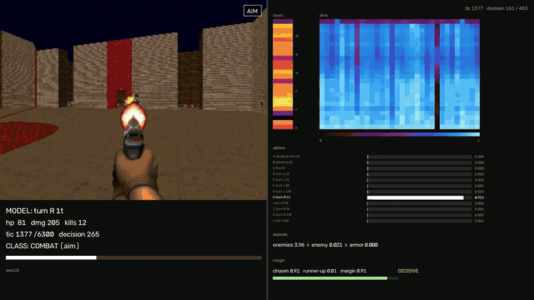

# dmodel

A 2B model plays deathmatch in ViZDoom. The state is a short text packet; the twelve
possible actions are appended as lettered options, and the model takes the highest of
those twelve logits at the final position. No text is generated.

Training is imitation. A scripted teacher plays, its decisions are recorded as rows of
state, options and label, and a rank-16 LoRA is fit to the choice.

## result

20 seeds (21-40), same arena, same starting state. Player-attributed kills / damage,
mean per episode:

| cap | teacher | student |
|-----|---------|---------|
| 2,100 tics | 20.75 / 272 | 19.70 / 254 |
| 6,300 tics | 34.90 / 422 | 31.65 / 382 |

Damage per 1,000 tics is about 140 for both. The student plays fewer long episodes
because it dies earlier.

## inside a decision

Six seconds of the 77-second clip from tic 1,632, one frame per game tic: the bot is
armed, turning onto a zombieman at close range with 15 kills on the counter. Left, the bot playing, with the
chosen option and its duration, health, damage, kills and the tic and decision numbers on
screen. Right, the model at that instant: residual magnitude at the final token for each
layer, a layer-by-dimension heatmap on a per-layer scale, the twelve option probabilities,
the field ablation this decision depended on, and the margin over the runner-up. Seed 22.

[full clip, 77 s](media/activation-22.mp4).

## method

The teacher is a hand-written policy: turn onto the largest visible enemy, fire within
1.8 degrees, hold the bearing for a few tics after the target leaves view, collect
health below 70, otherwise walk the patrol controller to the next spawn zone.

The student reads the same text with the twelve option strings as lettered choices. The
loss is label-smoothed cross entropy plus a Brier term at weight 1.0, over the softmax of
the twelve letter tokens. Checkpoints are picked by playing episodes, because held-out
accuracy picks worse ones than play does.

The option text states its own tic count, so "turn left 8 tics, 28 deg" cannot drift
from what the harness executes. Navigation is itself an option (index 11), so the model
chooses when to hand control to the BFS patrol instead of computing a route. With eleven
motor options alone it collapsed onto one action for 2.30 kills.

## reproducing

    python scripts/make_arena.py                 # data/deathmatch-lowpress.wad + arena.cfg
    PYTHONPATH=src python -m dmodel.record --out corpus/key12.jsonl
    PYTHONPATH=src python -m dmodel.train --corpus corpus/key12.jsonl --out adapters/dm-key12
    PYTHONPATH=src python -m dmodel.evaluate --adapter adapters/dm-key12 --seeds 21-40

`make_arena.py` needs a stock `deathmatch.wad` from the vizdoom scenarios directory.
Recording 20 episodes at cap 6,300 gives about 12k rows and takes under a minute;
training is about 2.5 s per optimizer step on one GPU.

`introspect` replays an episode and dumps per-layer activation norms, the top-variance
hidden dimensions and a field-ablation table, which is where the write-up figures came
from. It is not part of the training path.

## metrics

Damage dealt (`DAMAGECOUNT`) is the headline rather than kills. `KILLCOUNT` also counts
monsters that kill each other, and on this map they do it often enough to move a 20-seed
mean by several kills. Player kills require damage to have risen in the same step, and
both numbers are printed.

Episodes end on death or at the cap, so tics played differ per episode and per policy.
Comparisons across policies are quoted per 1,000 tics for that reason. Deaths come from
the game's own death state, not from health crossing zero.

## calibration

Held out by episode: the last 5 of 20 recorded episodes, 2,379 decisions. Rows from a
single episode are near duplicates, so a row split reports a skill the model does not
have.

    accuracy        0.973
    brier           0.0436 -> 0.0410
    ece             0.0822 -> 0.0148

The raw probabilities average 0.904 against an accuracy of 0.973, so it is underconfident
overall and overconfident on the 58 decisions it is least sure about, where accuracy runs
23-50%. A temperature of 0.60, fitted on the other episodes, gives the numbers above.

Escalating below a threshold:

    threshold   kept    acc(kept)   escalated   errors caught
    0.80        98.3%   0.983       1.7%        37.5%
    0.90        97.6%   0.988       2.4%        57.8%
    0.95        96.5%   0.992       3.5%        71.9%

At 0.95 it hands up 3.5% of decisions and catches 72% of the errors; the 96.5% it keeps
run at 99.2%.

This measures agreement with the teacher, not whether the decision was good. A call the
teacher would not have made can still be right, and counts as an error here.

## layout

    src/dmodel/actions.py      option tables and tic counts
    src/dmodel/observation.py  state text
    src/dmodel/env.py          vizdoom wrapper, metrics
    src/dmodel/nav.py          walkability grid, bfs, patrol
    src/dmodel/teacher.py      scripted policy
    src/dmodel/readout.py      prompt, letter readout, model loading
    src/dmodel/rollout.py      one episode of play, shared move functions
    src/dmodel/calibrate.py    episode-level holdout, ece/brier, escalation
    src/dmodel/{record,train,evaluate,introspect}.py   entry points

`python -m pytest tests` runs the two invariant checks. They need no GPU; the metrics
test needs vizdoom importable.

MIT licensed, see LICENSE.
